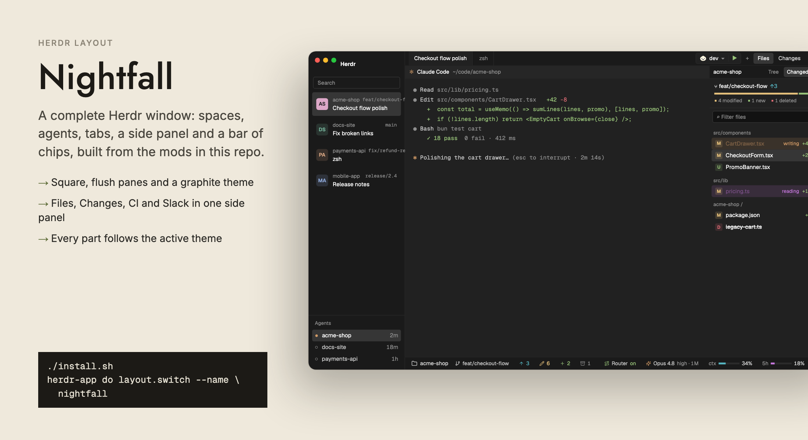
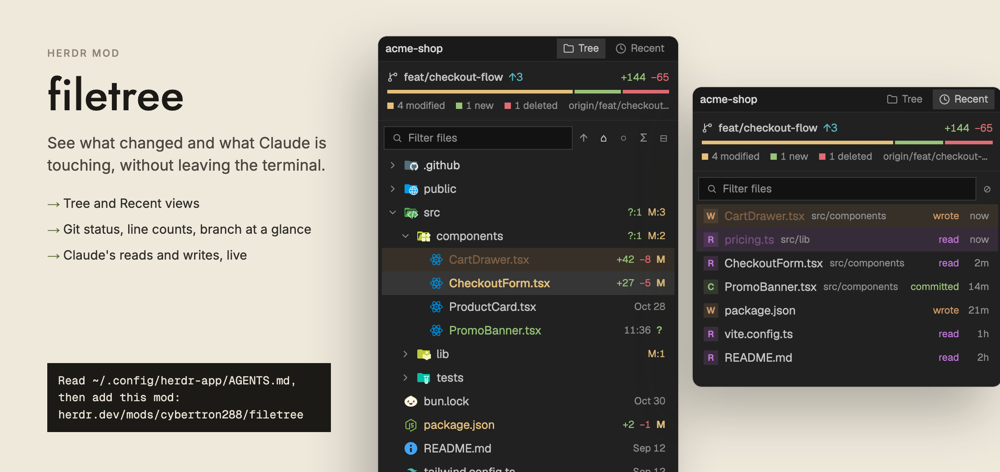
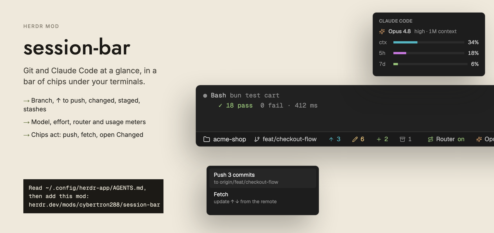
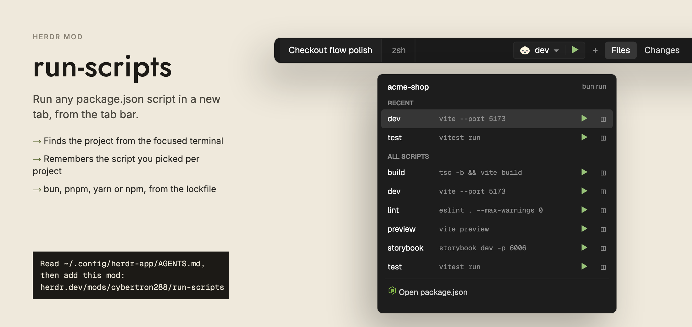
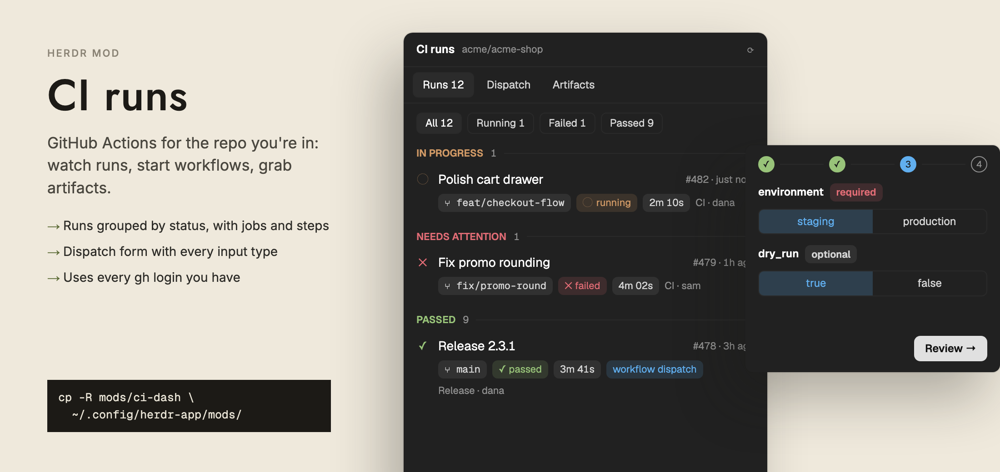
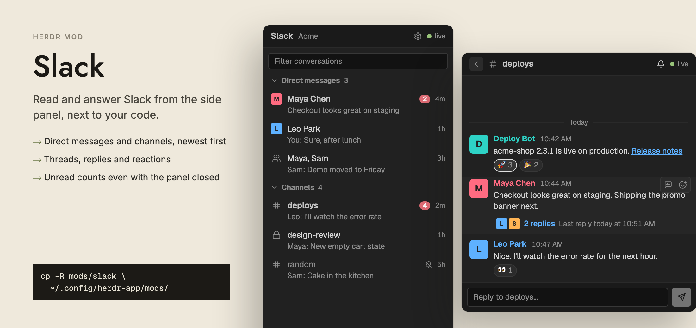
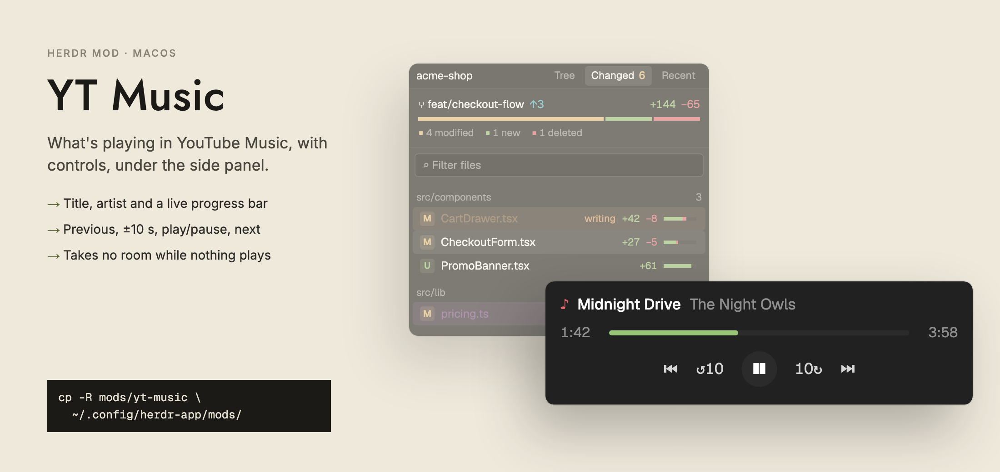
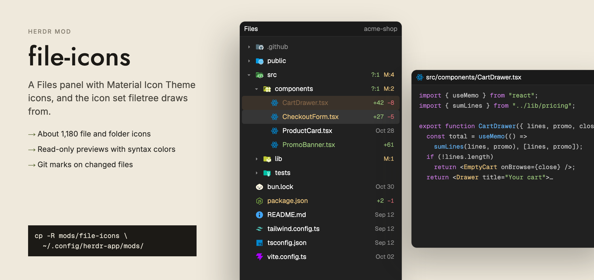
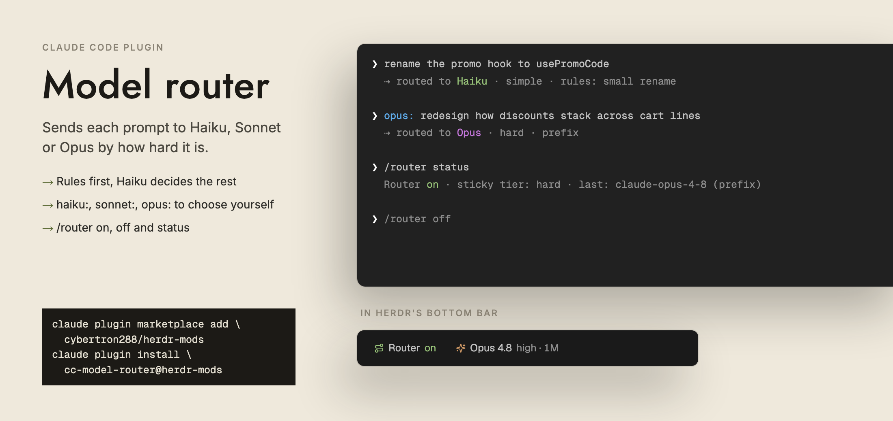

# herdr-mods

Mods, a layout and Claude Code plugins for the [Herdr app](https://herdr.dev), the desktop
window for terminals and coding agents.

Every Herdr mod here takes its colors from the active theme, so it works in any layout.
The **Nightfall** layout puts them all together.



## What's inside

### Herdr mods (`mods/`)

| Mod | What it does | Needs |
|---|---|---|
| [`filetree`](mods/filetree) | File tree with Tree / Changed / Recent tabs, git status, search, previews, and Claude's reads and writes highlighted | `file-icons` (icons); optional Claude hook for activity |
| [`file-icons`](mods/file-icons) | A Files panel with Material Icon Theme icons; also the icon set `filetree` uses | — |
| [`session-bar`](mods/session-bar) | Bottom bar of chips: folder, branch, ↑ ↓, changed, staged, stashes, and Claude's model, effort, router and usage meters | its Claude Code plugin (installed with it); optional: `cc-model-router` |
| [`run-scripts`](mods/run-scripts) | Run control for JavaScript projects: pick a `package.json` script and run it in a new tab | — |
| [`ci-dash`](mods/ci-dash) | GitHub Actions for the repo you're in: runs, dispatch, artifacts | `gh`, logged in |
| [`slack`](mods/slack) | Read and answer Slack in the side panel | a Slack app (set up from the panel) |
| [`yt-music`](mods/yt-music) | Now playing and controls for YouTube Music in Chrome | macOS, Google Chrome |
| [`nightfall-*`](layouts/README.md) | The Nightfall layout's own parts: sidebar, spaces, agents, tab bar, pane header, Changes panel | the Nightfall layout |

### Layout and theme

- `layouts/nightfall.json` and `layouts/nightfall.svg`: the Nightfall layout. See [layouts/README.md](layouts/README.md).
- `themes/nightfall.json`: its graphite theme.

### Claude Code plugins (`claude-plugins/`)

| Plugin | What it does |
|---|---|
| [`session-bar`](claude-plugins/session-bar) | The Claude Code half of the `session-bar` mod: sends model, effort, context window and usage to the bar. Installed with the mod by `./install.sh`. |
| [`cc-model-router`](claude-plugins/cc-model-router) | Routes each prompt to Haiku, Sonnet or Opus by how hard it is. `/router on`, `off`, `status`. |

The two plugins are independent: each writes its own file
(`~/.local/state/herdr-session-bar/` and `~/.local/state/herdr-model-router/`), and
`session-bar` only reads the router's state when the router is installed.

## A closer look

[](mods/filetree)

[](mods/session-bar)

[](mods/run-scripts)

[](mods/ci-dash)

[](mods/slack)

[](mods/yt-music)

[](mods/file-icons)

[](claude-plugins/cc-model-router)

The screenshots use made-up projects, people and numbers.

## Install

### Everything, with the script

```sh
git clone git@github.com:cybertron288/herdr-mods.git
cd herdr-mods
./install.sh            # copies mods, layout and theme into ~/.config/herdr-app
```

It also installs the `session-bar` Claude Code plugin, the part of `session-bar` that runs
inside Claude Code, when the `claude` command is on your PATH.

The script never overwrites a folder or file you already have; it skips it and says so.
Pass `--force` to replace them. It runs `herdr-app check` on every mod it copies.
Then switch to the layout with `herdr-app do layout.switch --name nightfall` (or
`ctrl-shift-l`).

### One mod by hand

```sh
cp -R mods/run-scripts ~/.config/herdr-app/mods/
herdr-app check ~/.config/herdr-app/mods/run-scripts
```

Every mod has `"place": "none"`, so it appears only where a layout puts it, or where you
open it:

```sh
herdr-app do pane.split --direction right --mod filetree
herdr-app do tab.new --name CI --mod ci-dash
```

Each mod's README says which block it fits and what it needs.

### Claude Code plugins

This repo is also a Claude Code plugin marketplace. `./install.sh` already installs
`session-bar`; by hand:

```sh
claude plugin marketplace add cybertron288/herdr-mods
claude plugin install session-bar@herdr-mods
claude plugin install cc-model-router@herdr-mods
```

The repository is private, so Claude Code needs git access to it (an SSH key or `gh`
login that can read it). Restart Claude Code sessions, or run `/reload-plugins`, after
installing.

If you already have these plugins from another marketplace, or the older `session-info`
plugin, disable those first so the same numbers aren't sent twice.

## Where things live

| Path | What |
|---|---|
| `~/.config/herdr-app/mods/<name>/` | the Herdr mods |
| `~/.config/herdr-app/layouts/`, `themes/` | layouts and themes |
| `~/.config/herdr-app/data/<mod>/` | mod state Herdr keeps (Slack tokens, YT Music state) |
| `~/.local/state/herdr-session-bar/<terminal>.json` | what the `session-bar` plugin sends to the mod |
| `~/.local/state/herdr-model-router/<terminal>.json` | what `cc-model-router` sends to `session-bar` |
| `~/.local/state/herdr-filetree/activity.jsonl` | Claude's file activity for `filetree` |

## Licence

MIT, see [LICENSE](LICENSE). Some mods include or adapt open-source work; their notices are
in [THIRD_PARTY_NOTICES.md](THIRD_PARTY_NOTICES.md).
