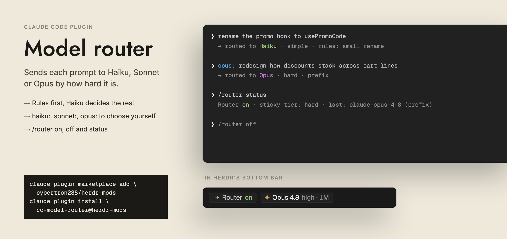

# cc-model-router



A Claude Code plugin that sends each prompt to Haiku, Sonnet or Opus by how hard it is.

- **Rules first:** short follow-ups, commands and plain questions are ranked by rules; when
  the rules can't tell, Haiku classifies the prompt.
- **Prefix to choose:** start a prompt with `haiku:`, `sonnet:` or `opus:` to pick the model
  yourself.
- **Sticky:** the chosen tier carries over to follow-ups until a prompt clearly needs another.
- **No edits on Haiku:** if Haiku tries to edit a file or run a writing command, the call is
  refused and the turn moves up to Sonnet, which retries it.

## Commands

`/router on`, `/router off`, `/router status` (the switch, the sticky tier and the last pick).

Every decision is logged to `~/.claude/cc-model-router/decisions.jsonl`.

## Install

```sh
claude plugin marketplace add cybertron288/herdr-mods
claude plugin install cc-model-router@herdr-mods
```

Then `/reload-plugins` or restart Claude Code.

## Inside Herdr

When `HC_TERMINAL_ID` is set, the router writes its switch and last pick to
`~/.local/state/herdr-model-router/<terminal>.json` at session start, on `/router on|off`,
and after each decision. The `session-bar` mod shows it as the **Router** chip.

## With session-info

Independent: each works without the other, and they write different files.
`session-info` reads the router's state to show the routed model; the router never reads
`session-info`.
