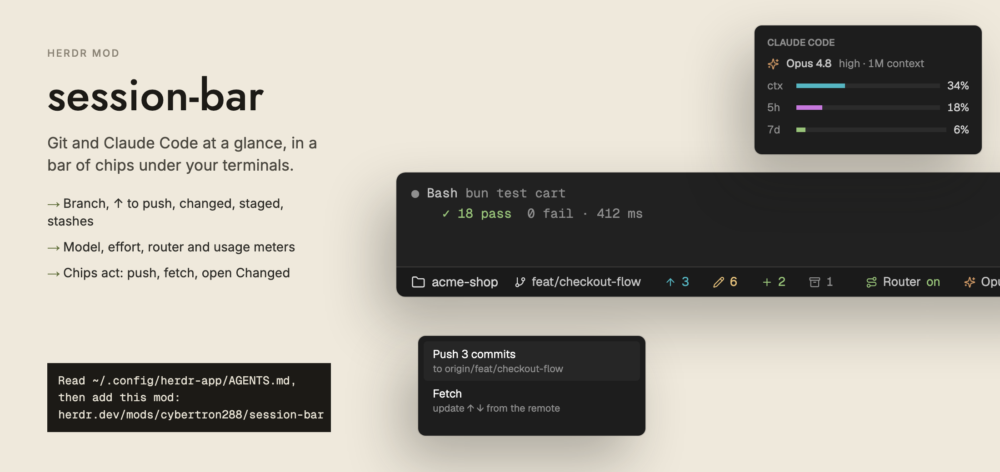

# session-bar



A bottom bar of chips for any Herdr layout: the focused terminal's folder and git state on
the left, Claude Code's model, router and usage on the right. Colors come from the theme.

It comes in two parts: this Herdr mod, and a Claude Code plugin of the same name in
[`claude-plugins/session-bar`](../../claude-plugins/session-bar) that sends Claude's numbers
to the bar. Without the plugin the git chips still work, but the Claude chips stay empty.

## Install

`./install.sh` at the repo root installs both parts. By hand:

```sh
cp -R mods/session-bar ~/.config/herdr-app/mods/
herdr-app check ~/.config/herdr-app/mods/session-bar
claude plugin marketplace add cybertron288/herdr-mods
claude plugin install session-bar@herdr-mods
```

Restart Claude Code sessions afterwards. The Claude chips appear after the session's next
reply.

Put it in a 28 px block, usually under the terminals:

```json
{ "id": "status", "type": "block", "size": { "px": 28 }, "content": { "mod": "session-bar" } }
```

## Left: the focused pane's folder and git

| Chip | Meaning | Click |
|---|---|---|
| folder | the focused pane's folder | — |
| branch | the current branch (tooltip: upstream) | copies the name |
| ↑ N | commits to push | Push / Fetch menu |
| ↓ N | commits to pull | Pull / Fetch menu |
| ✎ N | uncommitted files, untracked included | opens filetree's Changed view |
| + N | staged files | — |
| ⚠ N | files with merge conflicts | opens filetree's Changed view |
| ▣ N | stashes | — |

The bar refreshes when files in the repo change, and every 8 s for panes on other machines.
In narrow windows (under 620 px) the staged and stash chips are hidden.

## Right: Claude Code

These chips show while the focused pane runs Claude Code:

- **Router** `on`, `off` or `disabled`, from the `cc-model-router` plugin. Hovering shows its
  last pick. No chip when that plugin isn't installed.
- **Model** with effort and context size ("Opus 4.8 high · 1M").
- **Meters** `ctx`, `5h` and `7d`, turning orange at 80% and red at 95%.

Clicking the model or a meter opens a card with every number.

## Where the Claude numbers come from

Herdr can't see inside Claude Code, so Claude Code plugins report to it:

| Chip | Plugin | File it writes |
|---|---|---|
| Model, effort, meters | `session-bar` (this mod's plugin) | `~/.local/state/herdr-session-bar/<terminal>.json` |
| Router | `cc-model-router` (optional) | `~/.local/state/herdr-model-router/<terminal>.json` |

Whether the router plugin is enabled is read from `~/.claude/settings.json`.

The plugin draws nothing in Claude's own window by default. Its line under the prompt can
be turned on for plain terminals; see its [README](../../claude-plugins/session-bar).
