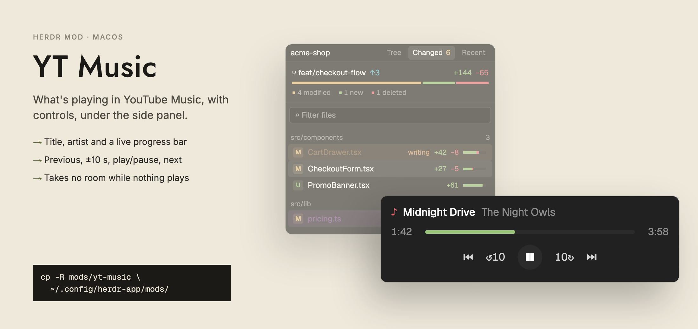

# yt-music



Now playing from YouTube Music in Google Chrome: the track, the artist, a progress bar and
previous, back 10 s, play/pause, forward 10 s and next. The block takes no room while
nothing plays and grows when a track does.

macOS only: it talks to Chrome through Apple Events.

## Set up Chrome

In Chrome: **View → Developer → Allow JavaScript from Apple Events**. Until then the block
shows a one-line reminder. Then play something on `music.youtube.com` in any tab.

## Install

```sh
cp -R mods/yt-music ~/.config/herdr-app/mods/
herdr-app check ~/.config/herdr-app/mods/yt-music
```

Add a block with the id `yt-music` (the mod resizes the block with that id), for example at
the foot of the side panel:

```json
{ "id": "yt-music", "type": "block", "size": { "px": 0 }, "min": 0, "content": { "mod": "yt-music" } }
```

## How it works

- `daemon.js` is the only process that talks to Chrome: one `osascript` kept running as a
  herdr-core terminal named `ytm-<hash>`, so a reload or a second copy reuses it. It reads
  the YouTube Music tab every second and writes
  `~/.config/herdr-app/data/yt-music/state.json` when the track, play/pause or position
  changes.
- The mod watches that file and moves the clock itself between writes. Buttons write
  `cmd.json`; the daemon ignores presses older than 5 s.
- The mod checks every 10 s that the daemon is running and starts it again if not.
