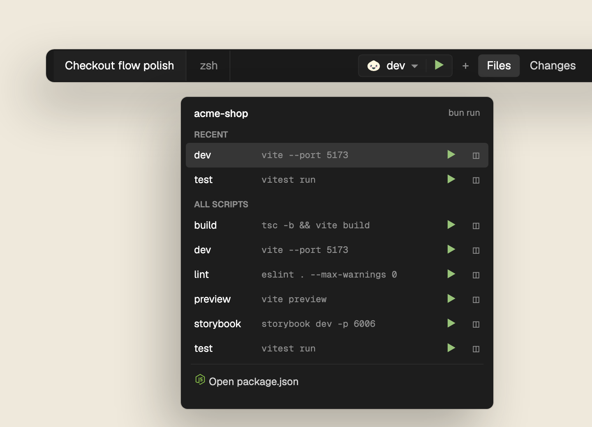

# run-scripts

A small run control for JavaScript projects, in the style of Android Studio. It shows the package manager icon, the chosen script name and a down chevron, then a play button. Click the name to open a list of every script in the project's `package.json`. Click play to run the chosen script in a new terminal tab. When the focused terminal is not in a JavaScript project, the control is not drawn at all.



## What you see

The control is one bordered box, 28px high, text 12.5px. It has two halves split by a 1px divider that is 16px tall.

- Box: background is the theme `background` (Nightfall: `#212121`), a 1px `border` line, rounded corners, contents clipped.
- Left half (the picker): 8px left padding, 6px right padding, 6px gap, at most 200px wide.
  - A 13px package manager icon. Colors: npm `ansi1`, pnpm `ansi3`, yarn `ansi4`, bun `foreground`.
  - The chosen script name in `foreground`, cut with an ellipsis if too long.
  - A 12px `chevron-down` icon in `dim` (Nightfall: `#8f8f8f`).
  - Tooltip: `<project name> · choose a script`.
- Right half (play): 8px padding on each side, a 13px `play` icon in `ansi2` (green). Tooltip: `Run <pm> run <script> in a new tab`.
- Each half gets the `hover` background on hover.
- Corner radius follows the shown layout's pane frame radius: the first tab block with a `pane` setting in the layout. It is clamped to 0 to 6 and is 6 when none is found.

The dropdown is a popup, 340px wide. Its height is `min(460, 96 + rows * 30 + 26 if there is a Recent section)`, where rows counts the Recent rows plus all script rows. It has 5px padding and the `popover` background (`surface` if there is no `popover`). Top to bottom:

1. Header: project name (12px, medium, cut with ellipsis) and, on the right, the command prefix in `dim` 11px, for example `bun run`.
2. A scroll list, with these sections:
   - `RECENT` caption, only if there are recent runs. Captions are 10.5px semibold `dim`, with 10px left padding.
   - `ALL SCRIPTS` caption, then one row per script.
3. A 1px `border` line with 6px side margin.
4. A 28px row, `Open package.json`, with a 13px `file-json` icon in `dim`.

Each script row is 30px high, 10px left padding, 4px right padding, 8px gap:

- Script name, 12.5px `foreground`, at most 130px, cut with an ellipsis.
- The script's command, 11px `dim`, takes the rest of the width and is cut with an ellipsis.
- A 24px square play button (13px `play` icon, `ansi2`). Tooltip `Run in a new tab`.
- A 24px square split button (13px `columns-2` icon, `dim`). Tooltip `Run beside the focused pane`.
- The two small buttons show the `raised` background on hover.
- The chosen script's row has the `selected` background. The other rows show `hover` on hover.

## How it behaves

**Finding the project.** The mod reads the folder of the focused terminal pane. If a layout terminal block is focused, it uses that block's folder. If the focused pane is not a terminal, it uses a terminal pane in the same tab. If there is no pane folder, it uses the active space's folder. From that folder it looks for `package.json`, then in the parent folder, up to 8 folders in all. On this machine it stops at the home folder or at `/`. On another machine it stops only at `/`. The first `package.json` found is the only one used.

**When it looks again.** It looks again when the focused folder or machine changes, and every 15 seconds so edited scripts show up.

**When nothing is drawn.** The control is hidden when:
- there is no `package.json` within 8 folders;
- the first `package.json` found is not valid JSON;
- it has no `scripts`, or none of the scripts is a string.

**Package manager.** In this order:
1. The `packageManager` field in `package.json`, if it starts with `npm@`, `pnpm@`, `yarn@` or `bun@`.
2. The first lockfile in the project folder, checked in this order: `bun.lock`, `bun.lockb`, `pnpm-lock.yaml`, `yarn.lock`.
3. Otherwise npm.

**Chosen script.** Each project folder remembers its own chosen script. With none remembered (or if the remembered one was removed), it picks `dev`, then `start`, then the first script in the file. Clicking a row in the list chooses it and closes the popup, but does not run it. Running a script also makes it the chosen one.

**Play (control or row).** Runs `<pm> run <script>`, which is `yarn run <script>` for yarn, in a new tab:
- The tab is named after the script and opens in the project folder, in the space that has focus.
- The shell stays open when the script ends.
- Herdr adds the tab at the end. 250 ms later the mod moves it to sit right after the tab you were on, if it is not already there.

**Split button.** Runs the same command in a new pane to the right of the focused pane. It does not pass the project folder.

**Recent list.** The last 3 scripts run in each project, newest first, with no repeats. Names that no longer exist in `package.json` are left out. The Recent section is not shown when the list is empty.

**Open package.json.** Opens the file in the default app: `open` on macOS, `explorer.exe` on Windows, `xdg-open` otherwise. If the project is on another machine, it shows an info toast, `package.json is on another machine`, instead. If the command fails, it shows an error toast.

## Built from

`mods/run-scripts/mod.json`:

```json
{ "place": "none" }
```

The mod places itself nowhere. Put it in a layout as its own block, or let a tab bar mod draw the control (see Watch out):

```json
{ "id": "run", "type": "block", "size": { "px": 220 }, "content": { "mod": "run-scripts" } }
```

As a block, the control is centered in the block and draws nothing outside a JavaScript project.

Files in `mods/run-scripts/`:

- `main.js`: the view. It draws the block (the control) or, with the `popup` prop, the dropdown.
- `scripts.js`: project detection, state, running and the control. It exports `MOD`, `findProject`, `selectedScript`, `recentScripts`, `select`, `commandFor`, `runScript`, `openMenu` and `control`.
- `play.svg`, `chevron-down.svg`, `columns-2.svg`, `file-json.svg`: Lucide icons (24px viewBox, stroke `currentColor`).

Props: none as a block. The popup is opened with `props: { popup: { project } }`, where `project` is `{ root, on, name, scripts: [{ name, cmd }], pm }`. The view reads `props()?.popup`, and uses `props().overlay` to close itself.

Imports: `gpui-kit` (`View`, `div`, `svg`), `gpui-base` (`v_flex`, `h_flex`), and from `herdr`: `readTextFile`, `exec`, `spaces`, `panes`, `focused`, `run`, `shared`, `setShared`, `home`, `theme`, `layout`, `props`, `openOverlay`, `closeOverlay`, `notify`, `window`.

Herdr commands, through `run(...)`:

- `tab.new {name, folder, argv, space}`
- `tab.move {id, index}`
- `pane.split {direction: "right", argv}`

The popup opens with `openOverlay({ mod: "run-scripts", kind: "popup", width: 340, height, props })`. The tab move uses `cx.timer.after(250, ...)`. Detection uses `cx.timer.every(15000, ...)` and `cx.spawn`.

Shared state, key `run-scripts`:

```json
{ "selected": { "<project root>": "<script>" }, "recent": { "<project root>": ["<script>", "..."] } }
```

Every copy of the control reads and writes this key, so they stay in step.

Files and programs outside the mod's folder:

- Reads `<dir>/package.json` with `readTextFile`, in each folder from the focused one up to 8 levels.
- Runs `sh -c` with a loop that tests for `bun.lock`, `bun.lockb`, `pnpm-lock.yaml` and `yarn.lock` in the project folder, through `exec`.
- Reads `icons/<pm>.svg` (`icons/npm.svg`, `icons/pnpm.svg`, `icons/yarn.svg`, `icons/bun.svg`) from Herdr's own `icons/` folder, not from the mod.
- Starts `npm`, `pnpm`, `yarn` or `bun` in a new tab or pane.
- Starts `open`, `explorer.exe` or `xdg-open` for Open package.json.

It does not use the network.

## Watch out

- **The list needs an explicit height.** A popup sizes to its content, so a `flex_1` scroll list gets no height. The list must state its own height, and it scrolls past 12 rows:

  ```js
  v_flex().id("rs-scroll").flex_none()
    .h(Math.min(360, (recent.length + p.scripts.length) * 30 + (recent.length ? 2 : 1) * 25))
    .overflow_y_scrollbar()
  ```

  The popup's own height (`openMenu`) must add up with it: 96px for the header, divider and footer, plus 30px per row, plus 26px if Recent is shown.
- **Mods cannot import across folders.** A tab bar mod that embeds the control must keep its own copy of `scripts.js` next to its `main.js` (Nightfall's tab bar uses `run-scripts.js`) and keep the copy the same as the original. Then it calls:

  ```js
  import { findProject, control } from "./run-scripts.js";
  // findProject(cwd, on) -> project | null
  // control(theme, radius, project, { height, stop })
  ```

  The dropdown is still this mod, opened as a popup by name, so `mods/run-scripts/` must be installed too. `stop` is a mouse-down handler that keeps a press from reaching a window-drag bar under the control.
- **It reads files outside its own folder and starts programs.** It reads `package.json` in the focused terminal's folder and its parents, runs `sh` to look for lockfiles, and starts `npm`, `pnpm`, `yarn` or `bun` (`<pm> run <script>`) in new tabs and panes. A package script can run any command, and the mod shows the command in the list so you can check it before you run it. Tell the person this before installing.
- **One `package.json` only.** The first one found going up is the project. A monorepo's workspace packages are not listed. It looks 8 folders up at most.
- **The package manager icons are not in the mod.** `icons/<pm>.svg` come from Herdr's `icons/` folder. If one is missing, the icon is blank.
- **The tab is moved after a delay.** `tab.new` adds the tab at the end, and the mod moves it 250 ms later. If the tab moves again or closes in that time, the move can miss it.
- **Split runs in the pane's folder.** `pane.split` is called with only `direction` and `argv`, so the new pane does not start in the project root unless the focused pane is there.
- **Remote machines.** Detection and the lockfile check run on the focused machine. Open package.json does not open files on another machine.
- **Chosen script is per project folder.** It is stored by the project root path, so the same project in two paths has two choices.

## Done when

- `herdr-app check mods/run-scripts` passes.
- In a folder with no `package.json` (and none within 8 parents), the block draws nothing.
- In a project with scripts, the control shows the package manager icon, the script name, a chevron and a play icon, in a 28px box.
- With `bun.lock` and no `packageManager` field, the icon is bun and the tooltip on play says `bun run <script>`. With `pnpm-lock.yaml` it says `pnpm run`; with `yarn.lock` it says `yarn run`; with no lockfile it says `npm run`.
- A `packageManager` field such as `pnpm@9.0.0` wins over a lockfile.
- With no remembered choice and a `dev` script, the control shows `dev`. With no `dev`, it shows `start`, then the first script.
- Clicking play opens a tab named after the script, in the project folder, right after the tab you were on, and the shell stays open when the script ends.
- Clicking the name opens a 340px popup with the project name, `ALL SCRIPTS` and one row per script with its command. Clicking a row changes the name on the control and does not run anything.
- After 2 runs, a `RECENT` section lists them, newest first, up to 3.
- The row's split button opens a pane to the right of the focused pane that runs the script.
- With more than 12 rows the list scrolls and the `Open package.json` row stays in view.
- `Open package.json` opens the file in the default app.
- Changing the focused terminal's folder to another project changes the control within one detection pass. Changing the chosen script in one copy of the control changes it in every other copy.

## Files

- `mods/run-scripts/mod.json`
- `mods/run-scripts/main.js`
- `mods/run-scripts/scripts.js`
- `mods/run-scripts/play.svg`
- `mods/run-scripts/chevron-down.svg`
- `mods/run-scripts/columns-2.svg`
- `mods/run-scripts/file-json.svg`
- `preview.png`
