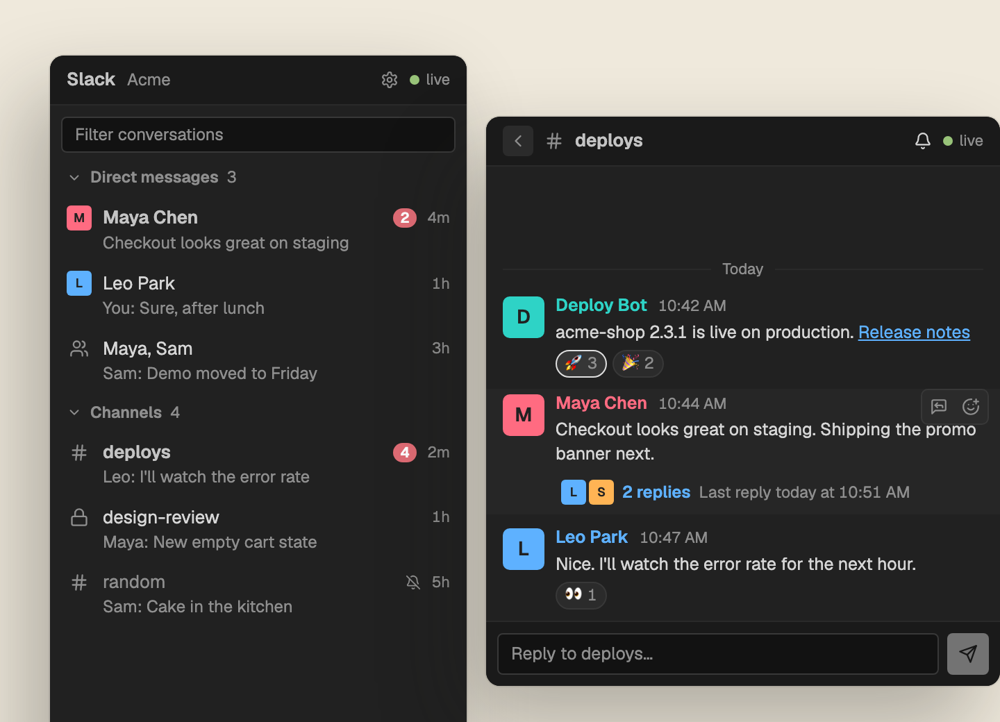

# Slack

A side panel that reads and answers Slack. It lists your direct messages and channels, newest first, with a live dot in the header, unread badges and a one-line preview per row. Click a row and the conversation fills the panel: messages with faces, names and times, emoji reactions, threads, a reply box and an @mention picker. A background copy of the mod keeps the one Slack connection open, so unread counts, toasts and a sound still arrive while the panel is hidden. The first time, a four-step wizard inside the panel sets up the Slack app and the two tokens.



## What you see

All colours are theme tokens from `theme()`, so the panel follows the active theme. Nightfall examples: `background` is `#212121`, `dim` is `#8f8f8f`. Text is 13px, `muted` colour, unless noted. The panel is one column: header, optional bars, then the list or the open conversation.

**Header** (36px high, `chrome` background, 1px `border` line under it, 12px side padding, 8px gap):
- Not in a conversation: "Slack" in `foreground`, semibold; the workspace name after it in 12px `dim`, truncated; a 22px gear button (`settings.svg`, tooltip "Slack settings"); on the right a 7px round dot and a word in 11px `dim`.
- The dot is `done` and the word is "live" when connected. It is `working` and "reconnecting" while the socket is down. Otherwise it is `dim` with "…". Its tooltip is the error text, else "Connected" or "Connecting".
- In a conversation: a 22px back button (`chevron-left.svg`, `raised` background, tooltip "Back to conversations"), the kind icon (14px, `dim`), the title in semibold `foreground`, then a 22px notification button. The gear is hidden there. The notification button shows `bell-off.svg` when the conversation is muted or set to Nothing, `at-sign.svg` for Just @mentions, else `bell.svg`. The tooltip says "Muted", "Notifications off", "Just @mentions" or "Notifications".

**Filter box:** a 26px input under the header, 8px side margin, 1px `input` border, 4px radius, 12px text. The placeholder "Filter conversations" is a `dim` overlay drawn while the box is empty.

**List:** a scrolling column with two groups, in this order: "Direct messages" (direct and group chats) and "Channels" (public and private). A group is skipped when it has no rows.
- Group header: 28px high, 11.5px `dim`, a 11px chevron (`chevron-down.svg` open, `chevron-right.svg` folded), the label in semibold, the row count, then on the right a badge with the group's unread total. The badge shows only when the group is folded and the total is above 0.
- Row: 6px vertical and 8px horizontal padding, 4px radius, `hover` background on hover. The first line has an 18px slot, the title, a badge, a bell-off mark and the age. The slot is the person's 18px face for a direct message once the picture is downloaded. Otherwise it is a 14px `dim` icon: `user.svg` (direct), `users.svg` (group chat), `lock.svg` (private channel), `hash.svg` (channel). The title is `muted`; unread rows use `foreground` and semibold. The age is 11px `dim`: "now", "5m", "3h", "2d". The second line is the preview in 12px `dim`, truncated, indented 26px. A group chat or channel preview starts with the writer ("Sam: text"); a direct message preview does not; your own start with "You: ".
- Unread badge: `blocked` background, white 10.5px semibold text, 8px radius, 5px side padding, shows the count.
- Muted rows (or rows set to Nothing) use the `dim` title and show a 11px `bell-off.svg`. Their badge shows only when there is an @mention.
- Empty states: "Loading conversations…", "No conversations yet.", "No conversation matches."

**Open conversation:**
- Messages sit on the bottom edge of the view. A day divider (1px `border` lines either side of the day in 11px `dim`: "Today", "Yesterday", "Mon, 3 Nov", with the year when it is not this year) opens each new day.
- A message has a 30px face (rounded 5px, the downloaded picture, or the first letter of the name on a coloured square) at the left, only on the first message of a run. A new run starts when the writer changes or more than 5 minutes pass. Later messages in a run have a 30px blank in place of the face. Above the text is the name in 12.5px semibold and the time ("3:07 PM") in 11px `dim`. The text is 12.5px `muted`.
- Name colours: your own name is `done` (green). Everyone else gets a colour from a six-colour set, picked by a hash of the Slack user id. In one conversation two people never share a colour; the second takes the next free one. Dark themes: `#5eb1ff #c792ea #ff6b81 #ffb454 #2ed3c6 #f2d74e`. Light themes: `#1f6fd1 #8a3fc7 #c9334a #b85f00 #0f8f86 #8a7500`. Dark or light is `settings().dark`.
- Links are `#5eb1ff`, underlined, with the address as tooltip. While the pointer is on one, an 18px copy button (`copy.svg`, then `check.svg` for 1.5 s) shows beside it.
- @mentions are chips: 2px side padding, 3px radius, medium weight. Dark: text `#1d9bd1` on `#1d9bd126`. Light: `#1264a3` on `#1d9bd11a`. A mention of you, or of @here, @channel, @everyone: dark text `#f2f2f2`, light `#1d1c1d`, both on `#f2c74466`.
- Reactions: chips 20px high, 10px radius, 11.5px, the emoji and the count. A chip you reacted with has an `accent` border and `selected` background; others have an `input` border and `raised` background.
- Files: a card up to 340px wide (1px `input` border, 6px radius, `raised` background) with a 32px icon box (`image.svg` or `file.svg`), the file name, and a line of type and size ("PDF · 2.1 MB"). On the right: a download button (`download.svg`), or after the download Open (`external-link.svg`) and Show in folder (`folder-open.svg`). A file kept outside Slack (Drive and the like) has an Open in the browser button.
- Thread link under a message with replies: 28px high row with up to 4 reply faces (18px), "3 replies" in `#5eb1ff` semibold, and "Last reply today at 3:07 PM" in 11.5px `dim`. On hover it says "View thread" and shows a chevron.
- Hover toolbar: while the pointer is on a message, the row gets a `hover` background and a small toolbar at the top right (`raised`, 1px `input` border, 5px radius, 22px buttons): Reply in thread (`message-square-reply.svg`, hidden inside a thread) and Add reaction (`smile-plus.svg`). Add reaction opens a row of 26px emoji buttons below the message: +1, heart, joy, tada, eyes, white_check_mark, pray, fire.
- "Latest ↓" pill (24px high, 12px radius, bottom right) shows once you have scrolled back more than 40px.
- In a thread, a 30px bar under the header holds a "Back" button and "Thread". The first message is the thread's parent, then a divider "N replies", then the replies.
- Reply box: 8px padding, `chrome` background, 1px `border` line above. A 30px input (placeholder "Reply to <title>…" or "Reply in thread…") and a 30px square send button (`send.svg`, `solid` background, `solid_foreground` icon, 45% opacity while the box is empty or a send is pending).
- Mention picker: type `@` and a word at the end of the box. A list of up to 6 people opens above the box (`popover` background, 1px top border) with the heading "PEOPLE  ·  ↑↓ to move, Enter or Tab to pick". A row is 30px: a 20px face, the name in semibold, and the real name or `@handle` in `dim`. The highlighted row has the `selected` background.
- Errors: a `blocked` 11.5px line under the messages: the open error, or "Couldn't send: …".

**Bars under the header** (list view; the first two also show in a conversation):
- Notification menu (only in a conversation, after tapping the bell): heading "NOTIFY ME ABOUT"; radio rows "Every new message", "Just @mentions" (channels and group chats only, hint "And @here, @channel"), "Nothing"; a divider; then "Mute channel" or "Mute conversation" (hint "No toasts or counts; @mentions still come through"), or "Unmute …" (hint "Toasts and counts come back").
- Paused bar: `moon.svg`, "Notifications paused until 3:07 PM" (adds the day name when not today) and a "Resume" link in `#5eb1ff`.
- Gear menu (list view only): a wrapping row of 28px buttons: Reconnect, Change tokens…, Pause notifications, Sound on / Sound off, Fix permissions…, Sign out. Pause opens a second row: "30 minutes", "1 hour", "2 hours", "Until tomorrow 9 AM". Sign out first reads "Sure? Sign out" for 4 seconds.
- Missing-permission bar (list view, when the token lacks a scope): a `working` (yellow) bar with `#1c1a16` text and `triangle-alert.svg`: "No <what>, <what>: permission missing", tooltip lists the scope names, and a "Fix" button.

**Not set up or failed:** a 16px-padded message. "Connecting to Slack…" before any state exists. "Slack isn't set up." with "Two tokens connect this panel to your workspace." and a "Set up Slack" primary button with `key.svg`. "Couldn't connect to Slack." with the error and a "Check the tokens" button.

**Setup wizard** (replaces the list; 14px padding, 14px gap, scrolls). A head row has `key.svg`, "Set up Slack" (or "Fix Slack permissions"), "Step N of 4", and an `x.svg` close button once both tokens exist and the status is not "setup". A 3px progress bar of four segments (`accent` up to the current step, `raised` after). Buttons are 28px high, 4px radius, 12px text; primary ones use `solid`. Numbered step lists use 18px round badges.
1. "Create the Slack app": buttons "Create Slack app" (opens the manifest link) and "Copy settings" (copies the manifest JSON; reads "Copied" for 1.5 s); a note on what to do if the form is empty; "I have the app".
2. "App token": four numbered instructions (Basic Information, Generate Token and Scopes, add `connections:write`, copy the `xapp-` token), "Open your Slack apps", a masked input with show (`eye.svg` / `eye-off.svg`) and paste (`clipboard.svg`) buttons, then "Check token" (or "Keep current token" if one is saved and the box is empty).
3. "User token": install instructions (three steps with Copy settings when permissions are missing), the same input, then "Check token". On success it shows "Signed in as <user> · <team>" with `check.svg`, plus one `working` line per missing scope: "reactions:write is missing: no reactions".
4. "Save and connect": rows App token, User token, Permissions with `check.svg` or `triangle-alert.svg`, the line "Saved in <folder>, readable by your user account only.", and a "Save and connect" button that is disabled until both tokens are checked or kept.
- Fix-permissions mode (gear menu) shows one step: the missing scopes, Copy settings, Open your Slack apps, a "Check permissions" button with `refresh.svg`, "Done" once nothing is missing, and a link "Slack gave you a new token? Paste it instead".

## How it behaves

**Connection.** The background copy reads both tokens at start. With none, or one, it sets status "setup" and the panel opens the wizard by itself (unless you closed it for this start). It calls `auth.test`, loads conversations and people, then starts Socket Mode. The status goes starting, loading, live, with "reconnecting" while the socket is down. After a drop it retries after 2 s, doubling to a 30 s limit, and resets to 2 s on success. A rejected token (`invalid_auth`, `not_authed`, `token_revoked`, `token_expired`, `account_inactive`, `not_allowed_token_type`, or `missing_scope` on the app token) sends the panel back to the wizard at the right step. Opening or closing the panel never reconnects. Reconnect, saving tokens and Sign out each start a new generation: the old socket closes and old loops stop.

**Unread counting.** Slack gives this token no way to mark a conversation read, so read state is kept locally.
- At start every conversation is asked for its newest message, one call every 1.5 s: direct messages first, then channels, then group chats, newest first. Conversations Slack marks dormant, or last heard from more than 60 days ago, are skipped. The first start goes through all of them (the list reorders as answers arrive). Later starts begin from the kept last messages.
- For a new last message that is not yours, was posted within 14 days and is newer than the local "seen" mark, one more call (`conversations.info`) gets Slack's last-read mark and count. The row's unread is Slack's count (at least 1) if that message is after the last-read mark, else 0.
- After that, each pushed message in a conversation that is not open adds 1 and sets the preview. An @you, @here, @channel or @everyone sets the mention flag.
- Opening a conversation sets its count to 0 and stores the newest message's time as "seen". A message arriving in the open conversation is appended and marked seen. Sending marks it seen too.
- The tab-button number is "loud" unread: all counts of direct and group chats that are not muted and not set to Nothing, plus any conversation with an @mention. Other channels stay quiet.
- Only the last message and its time are kept between starts, so the list is in order at once.

**Notifications.** Per conversation, as in Slack: "Every new message" (default), "Just @mentions", "Nothing", plus Mute. A direct message counts as a mention.
- A message makes a toast when notifications are not paused and the level allows it: All always; Just @mentions only for an @mention or a direct or group chat; Nothing never. Muted conversations toast only for an @mention.
- Thread replies make a toast only for direct or group chats or @mentions, and not when that thread is open. They do not change unread counts.
- The toast is Herdr's own: title is the person's name for a direct message, else "Name · #channel" (threads read "Thread in #channel" or "Reply in your thread"); the body is the first 160 characters; the icon is the writer's picture once downloaded, else `toast-icon.svg`; it stays 12 seconds. Clicking it runs `slack.goto-<id>[-<thread ts with _ for .>]`, which selects the Slack child of the stack `panel-body`, shows `panel`, and opens that conversation or thread.
- Sound: `knock.mp3` plays with each toast, at most once every 1.5 s. It stays quiet if `settings().sounds.enabled` is false or the gear menu says "Sound off". Switching sound on plays it once.
- Pause (gear menu) silences every toast and sound until the time you pick; the bar shows it and "Resume" ends it. It ends by itself at the time. `slack.pause-<minutes>` and `slack.resume` do the same from the command line.
- Notification level, mute, sound and pause are saved in the background copy's `localStorage` and survive restarts.

**Threads.** "Reply in thread" or the "N replies" row opens the thread (the parent plus up to 200 replies from `conversations.replies`) in the same view. Replies you send there carry `thread_ts`. Live replies add to the open thread and bump the "N replies" count and the reply faces on the parent. "Back" returns to the conversation.

**Reactions.** Click a chip to add or take back your reaction; the toolbar's picker adds one of eight quick emoji. Names map to characters through `emoji-map.js`, then a short built-in table; a workspace's own emoji show as `:name:`. The chip updates at once from Slack's answer (`already_reacted` and `no_reaction` count as success). Without `reactions:write` the conversation shows "Reacting needs the reactions:write permission: gear menu → Fix permissions." The token file is re-read once first, so a fixed token works without a restart.

**Files.** The download button saves the file under its own name into `~/Downloads` (the folder is created if missing). A file that already exists is kept and the new one gets `.1`, `.2`. The card then says "Saved to Downloads", a toast "Downloaded <name>" shows for 6 s, and Open and Show in folder appear. A Slack sign-in page, or a 401 or 403, is reported as needing `files:read`. The download stops after 25 seconds.

**Older history.** A conversation opens with its newest 40 messages. Scrolling back to within 40px of the top loads the 40 before the oldest, once per oldest message. Scrolling is a custom offset, with "Latest ↓" to jump back.

**Links and mentions in messages.** `<url|label>` shows the label, `<@U1>` shows `@name`, `<#C1|general>` shows `#general`, `&lt; &gt; &amp;` are decoded, `:emoji:` becomes the character, and `*bold*`, `_italic_` and `~strike~` markers are dropped (one style per line). Clicking a link opens it in the browser. Typing `@` offers people; the name stays as `@Name` in the box and is sent as `<@id>`. A typed-out `@handle` that matches a person is also turned into a mention. Enter sends, or picks the highlighted person while the list is open; Tab also picks; Esc closes the list. Up and Down move in the list.

**Other.** Filter matches titles, ignores folded groups while it has text, and also finds conversations with no known message. Without a filter, conversations with no message found are hidden. Each group shows at most 100 rows.

**Commands** (`herdr-app do slack.<name>`): `open-<title with _ for spaces>`, `close`, `thread`, `unthread`, `notif`, `type-<text>`, `pick`, `download-latest`, `setup`, `setup-fix`, `setup-1` to `setup-4`, `setup-close`, `reconnect`, `toast-test`, `goto-<id>[-<ts>]`, `pause-<minutes>`, `resume`.

## Built from

**`mods/slack/mod.json`**

```json
{ "place": "none", "title": "Slack" }
```

**Mod name.** It must be `slack`: every icon path is `mods/slack/<name>.svg`, avatars are `data/slack/avatars/…`, and commands are `slack.<name>`.

**One class, two roles**, chosen by `props()`:
- `{ "bg": true }` holds everything: tokens, REST calls, the websocket, counts, toasts. It draws `div().size(0)`.
- `{ "panel": true }` draws and only sends commands.

**Layout blocks.** Put the bg block where it is always shown, not inside a stack. Put the panel block in a side panel stack:

```json
{ "id": "slack-bg", "type": "block", "size": { "px": 0 }, "content": { "mod": "slack", "props": { "bg": true } } },
{ "id": "slack", "type": "block", "content": { "mod": "slack", "props": { "panel": true } } }
```

The toast click runs `layout.select {stack: "panel-body", child: "slack"}` then `layout.show {id: "panel"}`, so the panel block must be a child with id `slack` of a stack with id `panel-body`, inside a node with id `panel`. If the layout names these differently, change those two `run(...)` calls in `goto`.

**Shared-state keys**
- `slack.state`: written by bg every 500 ms when something changed. Fields: `me`, `status` ("starting", "loading", "live", "reconnecting", "setup", "error"), `error`, `team`, `convs` (each `{id, kind, title, unread, mention, preview, ts, user, muted, level}`, kind is `im`, `mpim`, `group` or `channel`), `open` (the open conversation with its messages and thread), `result` (the last send: `{n, ok, error}`), `soundOn`, `pauseUntil`, `scopedAt`, `avatars` (user id to `data/slack/avatars/<file>`), `downloads`, `gen`, `needs`, `has`, `missing`.
- `slack.cmd`: written by the panel: `{ n, type, ... }`, where `n` is `<Date.now()>.<counter>`. bg polls it every 250 ms and runs each `n` once, ignoring the one already there at start. Types: `open`, `close`, `send`, `older`, `react`, `thread`, `unthread`, `download`, `notif`, `pause`, `sound`, `rescope`, `reload`, `toasttest`.
- `slack.unread`: a number, the loud unread count. Other mods can show it.
- `slack.people`: list of `{id, name, real, handle}`, for the @ picker (no deleted users, bots or Slackbot).

**`herdr` functions:** `theme`, `settings`, `props`, `appHome`, `home`, `readTextFile`, `writeTextFile` (setup.js), `notify` (with `icon`, `timeout`, `action: { name }`), `shared`, `setShared`, `nextCommand`, `exec`, `window` (platform), `playSound`, `run`. Also `fetch`, `localStorage`, `fs/promises`, `WebSocket` from `websocket`, `View`, `div`, `svg`, `image` from `gpui-kit`, and `v_flex`, `h_flex`, `InputState`, `Input` from `gpui-base`. Clipboard and links use the view's `cx`: `read_from_clipboard`, `write_to_clipboard`, `open_url`.

**Programs run** (through `exec`): `curl` for pictures (`-sfL --max-time 20`) and downloads (`-sfL --max-time 25 --create-dirs --no-clobber -H @<header file> -o <target> -w …`); `chmod 700` on the folder and `chmod 600` on each token (Windows: `whoami` and `icacls`); `rm -f` (Windows: `cmd /c del /q`) for the header file and rejected downloads; `open -R <path>` (macOS) or `explorer /select,<path>` (Windows) for Show in folder, and on Linux the folder URL is opened with `open_url`.

**Slack app (the manifest the wizard uses).** Name "Herdr" (Slack does not allow "Slack" in an app name). Opened at `https://api.slack.com/apps?new_app=1&manifest_json=<url-encoded JSON>`; Copy settings copies the same JSON.

```json
{
  "display_information": { "name": "Herdr", "description": "Read and answer Slack from Herdr's side panel." },
  "oauth_config": { "scopes": { "user": [
    "channels:read", "groups:read", "im:read", "mpim:read",
    "channels:history", "groups:history", "im:history", "mpim:history",
    "users:read", "chat:write", "reactions:write", "files:read" ] } },
  "settings": {
    "event_subscriptions": { "user_events": ["message.channels", "message.groups", "message.im", "message.mpim"] },
    "interactivity": { "is_enabled": false },
    "org_deploy_enabled": false,
    "socket_mode_enabled": true,
    "token_rotation_enabled": false
  }
}
```

The app-level token (`xapp-`) needs `connections:write`. The user token is `xoxp-`.

**What each scope is for** (the wizard lists these when one is missing): the four `:read` scopes put conversations in the list; the four `:history` scopes read them; `users:read` gives names and pictures; `chat:write` sends; `reactions:write` reacts; `files:read` downloads.

**Files in `data/slack/`** (under `appHome()`):
- `app-token`, `user-token`: the token plus a newline. Folder mode 700, files 600. Removed by Sign out.
- `avatars/<uid>-<hash>.<ext>`: profile pictures, kept between starts.
- `.download-auth`: `Authorization: Bearer <user token>`, mode 600, exists only during a download, deleted afterwards.
- Also written, outside the folder: files in `~/Downloads`. The `localStorage` of the bg copy holds `sound`, `seen`, `cache`, `prefs`, `pauseUntil`.

**Slack calls.** Web API at `https://slack.com/api/<method>`, GET with a query string or POST with a JSON body, `Authorization: Bearer <token>`. A 429 becomes the error "Slack is rate limiting this app; try again in a minute".
- With the user token: `auth.test`, `users.conversations` (types `im,mpim,public_channel,private_channel`, not archived, 200 a page, up to 10 pages), `users.list` (200 a page, up to 8 pages), `users.info` (up to 8 unknown people at a time), `conversations.history` (limit 1 for the list, 40 for opening, `latest` for older), `conversations.info`, `conversations.replies` (limit 200), `chat.postMessage` (with `thread_ts` in a thread), `reactions.add`, `reactions.remove`, and a file's `url_private_download` through curl.
- With the app token: `apps.connections.open` (POST), then `WebSocket.connect(url)`.
- Socket Mode: reply `{ "envelope_id": … }` to every envelope that has one; `hello` sets live; `disconnect` ends the loop and reconnects; `events_api` carries `message` events. Subtypes handled: none, `thread_broadcast`, `file_share`, `me_message`, `bot_message`. Other subtypes (edits, deletions, joins) are ignored.
- Token checks in the wizard: the app token by `apps.connections.open`, the user token by `auth.test`. Missing scopes are found by probing five calls with fake ids (`files.info` F0000000000, `reactions.add` and `chat.postMessage` on channel C0000000000, `conversations.list`, `users.list`). A `missing_scope` error carries the list of scopes the token has (`provided`). Nothing is posted or changed.

## Watch out

- **It reaches the network.** It talks to `slack.com` (Web API and a Socket Mode websocket) and downloads profile pictures and files from Slack's servers, all through `fetch`, `WebSocket` and `curl`.
- **It stores tokens on disk.** `data/slack/app-token` and `user-token` are plain text, readable only by your user (`chmod`, or `icacls` on Windows). The user token acts as you in Slack. Sign out deletes both files.
- **It plays a sound** (`knock.mp3`) with each toast, and shows toasts.
- **It writes to `~/Downloads`**, and runs `curl`, `chmod`, `rm`, `open`, `explorer`, `icacls`.
- **Slack cannot mark read with this token.** Read state is local only. Opening a conversation here does not clear it in Slack, and Slack's own apps will still show it unread.
- **Rate limits.** Slack allows about 50 calls a minute per method. The first start asks every conversation once at 1500 ms apart (about 10 minutes for 400 conversations), each call capped at 15 s. A 429 makes it wait 20 s and retry, up to 3 tries. Do not speed this up.
- **Old news is ignored.** A last message older than 14 days is never unread, so an old app DM does not show as unread forever. Conversations quiet for 60 days are not looked at again until someone writes in them or you open them.
- **Counts are only as old as the app's view.** The count is Slack's `unread_count_display` at hydration time, then +1 per pushed message. A message sent while Herdr was closed is counted at the next start, once.
- **No `Intl`.** Dates and times are formatted by hand (`Date` getters, a month array, 12-hour clock). Keep it that way.
- **Two copies, one state.** `localStorage` is per mod copy, so notification settings, pause, sound, seen marks and the preview cache live in the bg copy only. The panel must never read them directly. If the bg block is missing, the panel shows "Connecting to Slack…" for ever.
- **Reactions, edits and deletes are not pushed.** Only message events are subscribed. Reactions made by others and edited or deleted messages appear when you reopen the conversation. Your own reactions update at once.
- **Slack's custom emoji** show as `:name:`; there is no image support.
- **Only the user token's scopes work.** With `files:read` missing, Slack answers a download with its sign-in page; the code treats that as the missing scope.
- **Private channel messages count as loud only with an @mention.** Direct messages and group chats always count (unless muted).
- **The header file:** the download passes the token with `-H @file`, never on the command line, so it does not show in the process list. Do not change that to `-H "Authorization: …"`.
- **Quiet failure by design:** most Slack errors surface as one-line notices ("Slack says channel_not_found"), not dialogs.
- **The panel's input is masked** in setup (`set_masked(true)`); a paste button reads the clipboard and strips whitespace.
- **File path of each icon** is `mods/slack/<name>.svg`; a build that renames the mod folder breaks every icon and the toast sound.

## Done when

- `herdr-app check mods/slack` passes.
- With no tokens in `data/slack/`, the panel opens the wizard at step 1 on its own. Create Slack app opens the manifest link. A wrong token (not starting `xapp-` or `xoxp-`, or `xoxb-`) is refused with its own message. Saving writes `app-token` and `user-token` with mode 600 in a 700 folder.
- After saving, the dot turns green and reads "live", the list shows "Direct messages" and "Channels" newest first, and rows fill in with previews and ages over the next minutes.
- Opening a row shows messages with day dividers, faces and per-person colours (yours green), and clears its badge. Scrolling to the top loads 40 earlier messages.
- Sending a message in the reply box posts it and empties the box. Typing `@` and two letters shows the people list; Enter inserts the name and sending turns it into a mention.
- Hover shows the Reply and Add reaction buttons. Clicking an emoji adds a reaction chip with your accent border; clicking it again removes it.
- A message with replies shows "N replies"; clicking opens the thread with a Back button; a reply sends into the thread.
- A message from someone else while the panel is closed raises a toast with their picture and plays `knock.mp3`; clicking the toast shows the panel on that conversation. `slack.toast-test` does the same for the latest direct message.
- The bell menu sets Just @mentions, Nothing and Mute; a muted row greys out with a bell-off mark and its badge goes away. "Pause notifications" shows the paused bar; Resume removes it.
- The gear's Sound off makes toasts silent. Sign out (two clicks) removes both token files and returns to the wizard.
- A file's download button puts it in `~/Downloads`, the card says "Saved to Downloads" and offers Open and Show in folder.
- Taking the network down turns the dot yellow with "reconnecting"; it returns to "live" on its own.
- With a token missing a scope, the yellow bar appears with "Fix", and the wizard's fix mode lists the missing scopes.

## Files

- `mods/slack/mod.json`
- `mods/slack/main.js` (the mod, both roles)
- `mods/slack/setup.js` (Slack calls, manifest, token checks, file locking, wizard)
- `mods/slack/emoji-map.js` (emoji name to character table)
- `mods/slack/knock.mp3` (toast sound)
- `mods/slack/*.svg` (Lucide icons: at-sign, bell, bell-off, check, chevron-down, chevron-left, chevron-right, clipboard, copy, download, external-link, eye, eye-off, file, folder-open, hash, image, key, lock, message-square, message-square-reply, moon, refresh, send, settings, smile-plus, triangle-alert, user, users, volume-2, volume-x, x; plus `toast-icon.svg`)
- `README.md`
- `preview.png`
