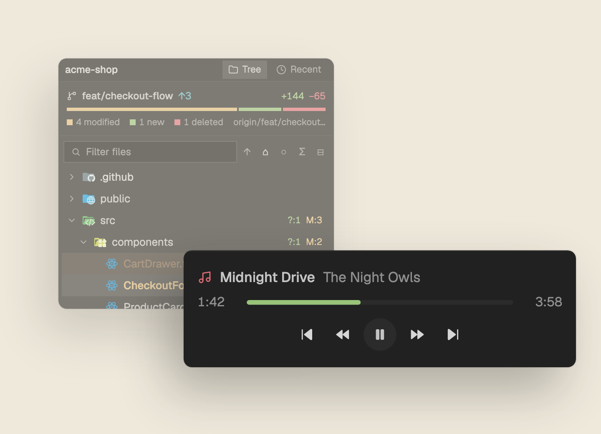

# YT Music

A small now-playing block for the foot of Herdr's side panel. It shows the track that plays in YouTube Music in Google Chrome: a music icon, the title and the artist, the elapsed and total time with a progress bar, and five round-ish controls. While nothing plays, the block is 0 px tall and you see nothing. When a track starts, it grows to 92 px. macOS only: it runs `osascript` and talks to Chrome through Apple Events.



## What you see

One block, full width of its column, with a 1 px top border (theme `border`) and the theme `background` fill. Text is 12 px, `muted` color. Content is centered vertically, 12 px of padding left and right, 6 px between rows, anything that overflows is clipped. Three rows, top to bottom.

1. **Track.** A Lucide `music` icon (12 px), then the title, then the artist, with 7 px between them. The title is medium weight and the artist is `dim`. Both truncate with an ellipsis; the artist shrinks twice as fast as the title. The icon is `ansi1` while playing and `dim` while paused. The title is `foreground` while playing and `muted` while paused. Hovering the row shows `<title> · <artist>`.
2. **Time and bar.** Elapsed time, the bar, total time, 8 px apart, 11 px text. Each time sits in a 34 px box in `dim`, in `m:ss` form (`3:07`; no hours, so 1 h 5 min reads `65:00`). The total is right-aligned. The bar is 4 px high with a 2 px radius, `raised` track, and a fill in `ansi2` while playing or `dim` while paused. The bar width is the block width minus 24 (padding), 68 (two times) and 16 (two gaps), never under 40 px, and it follows the block width when it changes by more than 2 px. Before the first width is known it assumes 360 px. With a total of 0 (a live stream) the fill is empty.
3. **Controls.** Five buttons, centered, 6 px apart, left to right: skip-back (24 px square, 4 px radius, "Previous"), rewind (24 px, "Back 10 s"), play/pause (28 px, fully round with a 14 px radius, `raised` fill, `foreground` icon), fast-forward (24 px, "Forward 10 s"), skip-forward (24 px, "Next"). All icons are 12 px Lucide icons in `muted`; on hover the button fills with `hover` and its icon turns `foreground`. The middle button shows the `pause` icon while playing and `play` while paused, with the tooltip "Pause" or "Play". The pointer is a hand.

Reminder line. When Chrome blocks scripting, the three rows are replaced by one row: a 12 px `music` icon in `dim`, then "Chrome: allow JavaScript from Apple Events" in `dim`, 11.5 px, truncated. Its tooltip reads "Chrome: View > Developer > Allow JavaScript from Apple Events".

Theme. Every color comes from `theme()`, so the block follows the person's theme. With Nightfall: background `#212121`, border `#2a2a2a`, text `muted` `#d6d6d6`, `dim` `#8f8f8f`, `foreground` `#c4c4c4`, `raised` (play button, bar track) `#2b2b2b`, `hover` `#262626`, `ansi1` (playing icon) `#e06c75`, `ansi2` (playing bar fill) `#98c379`.

Block height. 92 px with a track, 36 px with the reminder line, 0 px with nothing to show.

## How it behaves

**Playing.** The title is `foreground`, the icon `ansi1`, the bar `ansi2`, and the middle button shows pause. The elapsed time and the bar move once a second. The mod works out the position as the last known position plus the time since that write, capped at the total.

**Paused.** The title turns `muted`, the icon and the bar fill turn `dim`, the middle button shows play. The clock and bar stand still.

**Nothing plays.** The block is 0 px. This holds when Chrome is not running, when no tab has `music.youtube.com` open, when the page has no `<video>` or no media metadata, and when Chrome does not answer within 3 s. The daemon writes `null` as the state in all of these cases. If Chrome is not running, the daemon does not ask it anything (that would start Chrome).

**Chrome setting off.** When the Apple Event error says JavaScript from Apple Events is turned off, the daemon writes `{"error":"js-off"}`. The block shows the reminder line at 36 px. It goes back to the track view on its own once the setting is on and a tab plays.

**Buttons.** A click writes `{action, n: Date.now()}` to `cmd.json`. The daemon runs it in the YouTube Music tab:

- previous: clicks the player's "Previous" control.
- back: sets `video.currentTime` to the current time minus SEEK_SECONDS (10), not below 0.
- toggle: plays the video if it is paused, else pauses it.
- forward: sets `video.currentTime` to the current time plus SEEK_SECONDS (10), with no upper cap by the mod.
- next: clicks the player's "Next" control.

Play/pause shows its change at once: the mod flips the paused state and freezes or restarts the clock locally, and the daemon's next write corrects it. After any command the daemon reads the tab again right away. A mouse-down on a button does not start a window drag.

**Clock.** Between daemon writes the mod advances the time itself (a 1 s timer redraws while a track plays). The daemon writes `state.json` only when something changed: another title or artist, play/pause, a total that differs by 1 s or more, or a position that is more than 2 s off from where the clock would be (a seek). A track that plays on undisturbed produces no writes.

**Refresh and re-read timing.**

- The daemon checks `cmd.json` every 0.5 s.
- While a tab plays, it reads Chrome every 1 s (every 2nd tick). With no tab found, it looks again every 5 s (every 10th tick).
- The mod reads `state.json` when the folder changes. It does not poll for that.
- As a backup, while a track plays, the mod reads the file again every 5 s, and at once when its clock runs more than 1 s past the total (end of track, so the next title shows without waiting for a folder event).

**Daemon restart.** Every 10 s the mod asks `hc ls --json` whether a live terminal with the daemon's name exists, and starts it again if not. It also checks after each button press. If it cannot tell (the command fails), it assumes the daemon is live so it never starts a second one. When the daemon source changes, the name changes too, so on the next start the mod ends any live `ytm-` terminal with an old name and starts the new one. When the block goes away (quit, another layout) the mod ends the daemon; a plain reload keeps it.

## Built from

**mod.json** (the block is placed by a layout, not by the mod):

```json
{ "place": "none", "title": "YT Music" }
```

**The layout block.** The mod resizes the block with the id `yt-music`, so a layout needs one with that id, for example at the foot of the side panel:

```json
{ "id": "yt-music", "type": "block", "size": { "px": 0 }, "min": 0, "content": { "mod": "yt-music" } }
```

The mod finds the node with `layout()`, runs `layout.show {id}` if it is hidden, and `layout.resize {id, px}` when `size.px` differs. It never hides the block: a hidden block does not start its mod, so the daemon would never start.

**Files in the mod folder** `mods/yt-music/`: `main.js` (a `View` class, imports `View, div, svg` from `gpui-kit`, `h_flex, v_flex` from `gpui-base`, `fs/promises`), `daemon.js`, `mod.json`, and the Lucide icons `music.svg`, `skip-back.svg`, `rewind.svg`, `play.svg`, `pause.svg`, `fast-forward.svg`, `skip-forward.svg`. Icons are referenced as `mods/yt-music/<name>.svg`.

**herdr functions** (from `"herdr"`): `appHome`, `readTextFile`, `watchFolder`, `hc`, `theme`, `run`, `layout`. Timers use `cx.timer.every` (1000 ms twice, 10000 ms once).

**hc commands:**

```
hc ls --json
hc kill <address | name>
hc run --name ytm-<hash> --bg --no-parent --rm --json -- osascript -l JavaScript <home>/mods/yt-music/daemon.js <home>/data/yt-music
```

`<hash>` is FNV-1a (32-bit, offset `0x811c9dc5`, prime `0x01000193`) of the text of `daemon.js`, as 8 hex digits. A terminal name can have only one live holder, so a second `run` fails with name taken and nothing else starts. Old `ytm-` terminals with another hash are ended with `hc kill <address>`.

**The daemon** is one long `osascript -l JavaScript daemon.js <data dir>` loop (JXA with `ObjC.import("Foundation")`). It never launches Chrome: it asks `Application("Google Chrome").running()` first. It reads the page with this JS, run in the first tab whose URL contains `music.youtube.com`:

```js
(() => {
  const v = document.querySelector('video'), m = navigator.mediaSession.metadata
  if (!v || !m) return ''
  return JSON.stringify({ title: m.title, artist: m.artist, paused: v.paused, seconds: v.currentTime, duration: v.duration || 0 })
})()
```

The prev and next buttons are found with `ytmusic-wiz-player-controls [aria-label="Previous"], ytmusic-player-bar [aria-label="Previous"]` (and `"Next"`), then `.click()`.

**The compiled script cache.** Each Apple Event goes through an `NSAppleScript` whose source wraps the JS in `with timeout of 3 seconds` and loops over `windows` and `tabs of w`. JXA has no timeout setting, so this is how a Chrome that never answers is cut off. The compiled script is kept in a `Map` keyed by its source text, one per distinct JS (the read and the five actions), and reused.

**Files in `data/yt-music/`** (under `appHome()`):

- `state.json`: the daemon writes it atomically (temp file renamed over it, so folder events may name the temp file). Content: `{title, artist, paused, seconds, duration, at}` where `at` is `Date.now()` when read; or `{"error":"js-off"}`; or `null`. The mod treats a missing or bad file as nothing playing.
- `cmd.json`: `{"action": "previous|back|toggle|forward|next", "n": <ms timestamp>}`. The mod writes it; the daemon deletes it once read. The daemon also accepts `{"action":"quit"}` (writes `null`, exits); the mod never sends it.

The mod creates the folder if it is missing and ignores folder events that name only `cmd.json`.

## Watch out

It runs a program and talks to another app. The daemon is an `osascript` process that sends Apple Events to Google Chrome and runs JavaScript inside the YouTube Music tab: it reads the video state and the media title and artist, and it can click, seek, play and pause. Nothing goes over the network. It reads and writes only `data/yt-music/`, but Chrome must allow it: **View > Developer > Allow JavaScript from Apple Events**. Until that is on, only the reminder line shows. If you add this mod to someone's window, tell them this first.

- **Keep the compiled scripts.** Making a new `NSAppleScript` on every read (twice a second) piled up Objective-C objects and `osascript` crashed with signal 11 after about 50 s. The `Map` keyed by source text is the fix. Do not put a changing value (a timestamp, a counter) into the script text, or the cache never hits and the crash returns. All varying data must be in the JS, which is fixed per action.
- **No autorelease pool.** The loop runs without one, so allocations in it are not released early. Hence one cached script per JS, and no per-tick objects that can be avoided. The loop is `for (;;)` with `delay(0.5)`.
- **Stale commands.** If the daemon is down when a button is pressed, `cmd.json` stays on disk. On start the daemon ignores a command whose `n` is 5 s or more old, so an old pause does not fire later. An identical command text twice in a row is ignored, but `n` differs each time.
- **End of track.** The clock would run past the total if the next write from the daemon were missed. So the mod reads `state.json` again as soon as the clock is over the total by 1 s, and every 5 s while playing, not only on folder events.
- **Timeouts.** The `with timeout of 3 seconds` block means a Chrome that hangs gives `gone`, which publishes `null`: the block collapses and comes back when Chrome answers. A button press waits behind a read that is in progress, so up to 3 s in that case.
- **Duplicates.** Do not start the daemon with `osascript` yourself. Use `hc run --name`, or a second one will fight over `cmd.json`.
- **First match only.** It reads the first YouTube Music tab it finds, in window order. Other tabs or windows are ignored.
- **Forward has no cap in the mod.** Seeking past the end is left to the page, which ends the track.
- **macOS only.** There is no Windows or Linux path, and no use of Chrome profiles or other browsers.
- **Hash name.** Editing `daemon.js` changes the daemon name, so the next start kills the old daemon and starts the new one.

## Done when

- `herdr-app check mods/yt-music` passes.
- With a layout block `{ "id": "yt-music", ... "size": { "px": 0 } }` and Chrome closed, the block is 0 px tall.
- `hc ls --json` lists exactly one live terminal named `ytm-<8 hex digits>` after the mod loads, and still one after a mod reload.
- Chrome with "Allow JavaScript from Apple Events" off and a `music.youtube.com` tab open: the block is 36 px and shows "Chrome: allow JavaScript from Apple Events".
- With the setting on and a track playing: the block is 92 px, shows the title, artist, `m:ss` times, and the elapsed time moves each second.
- Clicking play/pause pauses the track in Chrome and the button shows the play icon at once; clicking again resumes it.
- Back and forward move the position by 10 s; previous and next change the track.
- Closing the YouTube Music tab makes the block 0 px again within a few seconds.
- Ending the `ytm-` terminal with `hc kill <name>` brings it back within 10 s.
- `data/yt-music/state.json` exists and changes on a pause, and `cmd.json` is deleted after a press.

## Files

- `mods/yt-music/mod.json`
- `mods/yt-music/main.js`
- `mods/yt-music/daemon.js`
- `mods/yt-music/music.svg`, `skip-back.svg`, `rewind.svg`, `play.svg`, `pause.svg`, `fast-forward.svg`, `skip-forward.svg`
- `preview.png`
